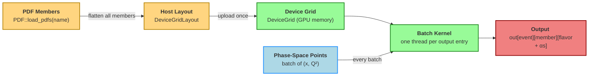

# GPU API

`NeoPDF` can evaluate PDFs on NVIDIA GPUs through the `neopdf_cuda` crate. It is designed
for batch interpolations (in MC event generators) that evaluate millions of independent
$(x, Q^2)$ points per integration step, and that propagate PDF uncertainties by re-evaluating
the same points for every member of a set:

- every member of a set is uploaded to the GPU **once** and stays resident for a whole run;
- a single call evaluates **all members and all flavors, plus $\alpha_s(Q^2)$**, at a batch
  of $(x, Q^2)$ points;
- inputs and outputs can stay on the device, on the caller's CUDA stream, with **no host
  round-trip**.

The interface is available natively in Rust, as a C library with a C++ object oriented
wrapper, and as a Python module.

!!! warning "Experimental"

    The GPU backend is built with [cuda-oxide](https://github.com/NVIDIA/cuda-rust), which
    NVIDIA describes as an early-stage project. It requires an Ampere or newer GPU (compute
    capability **sm_80+**) and a CUDA 13 driver (**R580+**) or newer.

---

## How it works



The colors distinguish the steps on the host (yellow) from those on the GPU (green), with
the per-batch inputs in blue and the output in red.

1. `DeviceGridLayout::build` flattens every member of a set into a handful of contiguous
   buffers (the grids and the interpolation coefficients of all subgrids, and the
   $\alpha_s$ tables). This step is pure Rust and runs on the CPU.
2. `DeviceGrid::upload` copies the layout to the GPU and loads the evaluation kernel.
3. Each batch call launches one GPU thread per output entry and fills an array of shape
   `[n_events][n_members][n_flavors + 1]`.

The kernel runs the same interpolation code as the CPU path, written once in plain Rust and
compiled for both the host and the device.

### Output layout

For `n_events` points, `n_members` members and `n_flavors` flavors, the output holds
`n_events * n_members * (n_flavors + 1)` values in row-major order. The value of flavor
column `f` of member `m` at event `e` is at

$$
\texttt{out}\big[(e \cdot n_\text{members} + m)\,(n_\text{flavors} + 1) + f\big],
$$

where the columns follow the order of the set's flavor PIDs, and the last column
(`f = n_flavors`) holds $\alpha_s(Q^2)$.

### Scope and accuracy

| | |
|---|---|
| **Supported sets** | Collinear $(x, Q^2)$ sets with `LogBicubic` or `LogChebyshev` interpolation, including sets split into several $Q^2$ subgrids (e.g. at flavor thresholds), and a tabulated or constant $\alpha_s$ |
| **Not supported (yet)** | `LogBilinear`, nuclear/TMD/$\xi$/$\Delta$ axes, analytic $\alpha_s$ |
| **Precision** | Double precision f64 |
| **Accuracy** | The host evaluation of the GPU code is bit-for-bit identical to `PDF::xfxq2_allpids`/`alphas_q2`; on the device, fused multiply-adds give agreement at the $10^{-12}$ relative level |
| **Out of range** | Same as the CPU: `LogBicubic` returns 0 outside the grid, `LogChebyshev` clamps to it, $\alpha_s$ returns 0 outside its table |
| **Positivity clipping** | The members' `ForcePositive` setting is applied (all members must share it) |

---

## Requirements and building

| Requirement | Version |
|---|---|
| GPU | NVIDIA, compute capability `sm_80` or newer (Ampere, Ada, Hopper, Blackwell) |
| Driver | R580 or newer (CUDA 13) |
| CUDA toolkit | 13.0 or newer, with `nvcc`, `cuda.h` and libNVVM |
| Rust | 1.99.1, Pinned by `neopdf_cuda/rust-toolchain.toml` |
| `cargo-oxide` | The cuda-oxide build driver |
| Clang | With `libclang` development headers |

First, install the pinned toolchain and `cargo-oxide`, then check the environment:

```bash
rustup toolchain install 1.99.1 --profile minimal -c rust-src,rustc-dev,llvm-tools,clippy,rustfmt
cargo +1.99.1 install --git https://github.com/NVIDIA/cuda-rust.git cargo-oxide

cd neopdf_cuda
export CUDA_TOOLKIT_PATH=/usr/local/cuda   # the toolkit root, e.g. /opt/cuda on Arch Linux
cargo oxide doctor
```

`neopdf_cuda` is a standalone crate, outside the main `NeoPDF` workspace, so that the
pinned toolchain and the GPU dependencies never affect the other crates. The GPU code
is built with `cargo oxide`, which passes regular Cargo arguments after `--`:

```bash
cargo test                                      # CPU-only parts, works without a GPU
cargo oxide test -- --features cuda             # + GPU tests
cargo oxide build -- --features capi --release  # C/C++ library
cargo oxide build -- --features python --release --target-dir target/python  # Python module
```

---

## Rust API

To use `neopdf_cuda` as an API, add the dependencies to your `Cargo.toml`. Until
`neopdf_cuda` is released, depend on the repository directly. `neopdf` must come from
the same source so that both crates share the same `PDF` type:

```toml
[dependencies]
neopdf = { git = "https://github.com/QCDLab/neopdf" }
neopdf_cuda = { git = "https://github.com/QCDLab/neopdf", features = ["cuda"] }
cuda-core = { git = "https://github.com/NVIDIA/cuda-rust.git", rev = "76ac1021660b0324c579d7cb57e847e7ffa3b9e1" }
```

and pin the toolchain with a `rust-toolchain.toml` containing `channel = "1.99.1"`
(see `neopdf_cuda/rust-toolchain.toml`). Finally, build and run your program with
`cargo oxide run`.

The examples below live in `neopdf_cuda/examples`; build them all and run one with

```bash
cargo oxide build -- --features cuda --release --examples
./target/release/examples/replica_uncertainty
```

The main Rust API types are:

| Type | Role |
|---|---|
| `neopdf_cuda::grid_prep::DeviceGridLayout` | All members of a set, flattened on the host; `build(&members)`, `n_members`, `pids`, `n_flavors()`, and `eval_batch` for a CPU evaluation of the same code |
| `neopdf_cuda::device::DeviceGrid` | The layout resident on a GPU; `upload(&stream, &layout)`, `output_len(n_events)`, `xfxq2_batch_host`, `xfxq2_batch_device` |
| `cuda_core::{CudaContext, CudaStream, DeviceBuffer}` | Device, stream and device memory handles from cuda-oxide |

---

### Example 1: Replica Uncertainties of All Members at Once

This example uploads every member of `NNPDF40_nnlo_as_01180`, evaluates them all in a
single batch from host arrays, and computes the gluon replica uncertainty together with
$\alpha_s$.

```rust linenums="1"
--8<-- "neopdf_cuda/examples/replica_uncertainty.rs"
```

Output on an NVIDIA RTX 4090:

```
         x         Q2             xg    uncertainty    alpha_s
    1.0e-5      1.0e4     1.811584e2     3.537228e0   0.116381
    1.0e-4      1.0e4     7.953343e1    8.894886e-1   0.116381
    1.0e-3      1.0e4     2.959156e1    1.330828e-1   0.116381
    1.0e-2      1.0e4     8.094095e0    4.103988e-2   0.116381
    1.0e-1      1.0e4    8.549174e-1    6.189669e-3   0.116381
    3.0e-1      1.0e4    8.494999e-2    2.169688e-3   0.116381
    5.0e-1      1.0e4    8.174854e-3    8.905509e-4   0.116381
    8.0e-1      1.0e4    2.336305e-5    6.591899e-6   0.116381
```

**Key points:**

- `DeviceGridLayout::build` checks that all members share the same grids, flavors and
  interpolation, and returns an error otherwise (e.g. for an unsupported set).
- `xfxq2_batch_host` copies the inputs to the device, launches the kernel and copies the
  results back into `out`, returning once `out` is filled.
- One batch gives all 101 members, so the PDF uncertainty costs a single call.

---

### Example 2: Device-Resident Batches on a Stream

This is the pattern of a GPU event generator: the grid and the buffers are allocated once,
and every batch is enqueued on the same stream without synchronizing the host. In a real
generator, the phase-space points would be produced on the device by the sampler, and the
kernels consuming the PDFs would follow on the same stream.

```rust linenums="1"
--8<-- "neopdf_cuda/examples/device_batches.rs"
```

Output on an NVIDIA RTX 4090:

```
50 batches of 20000 events x 101 members
throughput: 193.0 M (event, member) pairs/s
max relative deviation from the host evaluation: 1.4e-12
```

**Key points:**

- `xfxq2_batch_device` only enqueues work: inputs, output and execution all stay on the
  device and on the given stream.
- `DeviceGridLayout::eval_batch` evaluates exactly the same code on the CPU, which makes
  it a convenient reference, or a fallback when no GPU is available.

---

## C++ OOP API

### Building and Linking

Build the C library from the `neopdf_cuda` directory:

```bash
cargo oxide build -- --features capi --release
```

This produces `target/release/libneopdf_cuda.so` and generates the C header
`include/neopdf_cuda.h`; the C++ wrapper is `include/NeoPDFCuda.hpp`. Compile against
them with, for example,

```bash
c++ -std=c++17 main.cpp -I neopdf_cuda/include -L neopdf_cuda/target/release -lneopdf_cuda \
    -I /usr/local/cuda/include -L /usr/local/cuda/lib64 -lcudart
```

where the CUDA runtime is only needed if your code uses it (e.g. `cudaMalloc`). Code
containing CUDA kernels is compiled with `nvcc` instead. The library is independent of
`neopdf_capi`, and both can be used in the same program.

The `neopdf::DeviceGrid` class manages the device memory (RAII) and throws on errors:

| Method | Description |
|---|---|
| `DeviceGrid(pdf_name, device = 0)` | Loads every member of a set and uploads it to GPU `device` |
| `num_members()`, `pids()` | Number of members, and flavor PIDs in output column order |
| `output_len(n_events)` | `n_events * num_members() * (pids().size() + 1)` |
| `xfxQ2_batch(xs, q2s)` | Host vectors in, host vector out |
| `xfxQ2_batch_device(xs, q2s, n_events, out, stream)` | Device pointers in and out, ordered on a `cudaStream_t`, without synchronizing |

---

### Example 1: Host and Device Interfaces

This example evaluates the same points through both interfaces. The device call uses
buffers and a stream owned by the caller, as an event generator would: the evaluation is
ordered within that stream, after the input copies and before the output copy.

```cpp linenums="1"
--8<-- "neopdf_cuda/tests/capi/check-oop.cpp"
```

Output:

```
--8<-- "neopdf_cuda/tests/capi/check-oop.output"
```

**Key points:**

- `xfxQ2_batch_device` accepts any device allocation of the grid's GPU, e.g. from
  `cudaMalloc`, and never frees it.
- Passing a `cudaStream_t` orders the evaluation within that stream without blocking the
  host; `nullptr` uses the default stream.
- Both interfaces run the same kernel and agree bit for bit; the central member agrees with
  the replica mean, as expected for an NNPDF set.

---

### Example 2: A Fully GPU-Resident Workflow

This example computes the toy gluon-gluon luminosity

$$
\frac{d\mathcal{L}_{gg}}{d\tau} = \frac{1}{\tau} \int dy \; x_1 \, g(x_1, Q^2) \, x_2 \, g(x_2, Q^2),
\qquad x_{1,2} = \sqrt{\tau}\, e^{\pm y}, \quad Q^2 = \tau s,
$$

for every member of the set, at $\sqrt{s} = 13.6$ TeV. The rapidity points are generated by
a CUDA kernel, the PDFs are evaluated by `NeoPDF`, and the products are reduced per member
by a second kernel, all on one stream. Only the final values, one per member, are copied
back to the host.

```cpp linenums="1"
--8<-- "neopdf_cuda/tests/capi/check-generator.cu"
```

Output:

```
--8<-- "neopdf_cuda/tests/capi/check-generator.output"
```

**Key points:**

- `NeoPDF` reads its inputs from, and writes its output to, buffers produced and consumed
  by your own kernels.
- Events `[0, n)` carry $x_1$ and events `[n, 2n)` carry $x_2$: both beams are evaluated in
  a single batch.

These examples are also the tests of the C++ interface: run them all with
`make -C neopdf_cuda/tests/capi test-examples`.

---

### C API

`neopdf_cuda.h` exposes the same functionality to C, with the conventions of the main C
API: an opaque handle released by a `_free` function, and status codes.

| Function | Description |
|---|---|
| `neopdf_device_grid_new(pdf_name, device)` | Loads and uploads a set; returns `NULL` if it is not supported or the device cannot be used |
| `neopdf_device_grid_free(grid)` | Releases the grid and its device memory |
| `neopdf_device_grid_num_members(grid)`, `neopdf_device_grid_num_pids(grid)` | Sizes |
| `neopdf_device_grid_pids(grid, pids, num_pids)` | Flavor PIDs, in output column order |
| `neopdf_device_grid_output_len(grid, n_events)` | Required output length |
| `neopdf_device_grid_xfxq2_batch_host(grid, xs, q2s, n_events, out, out_len)` | Host arrays in and out |
| `neopdf_device_grid_xfxq2_batch_device(grid, xs, q2s, n_events, out, stream)` | Device arrays in and out, on a `CUstream`/`cudaStream_t` |

The fallible calls return a `NeopdfCudaResult`: `NEOPDF_CUDA_RESULT_SUCCESS`,
`NEOPDF_CUDA_RESULT_ERROR_NULL_POINTER`, `NEOPDF_CUDA_RESULT_ERROR_INVALID_LENGTH` or
`NEOPDF_CUDA_RESULT_ERROR_DEVICE`. See
[check-capi.c](https://github.com/Radonirinaunimi/neopdf/tree/master/neopdf_cuda/tests/capi/check-capi.c)
for a complete C example.

---

## Python API

### Building and Installing

The Python module is the library built with the `python` feature, in its own target
directory so that it does not overwrite the C library:

```bash
cd neopdf_cuda
cargo oxide build -- --features python --release --target-dir target/python
```

Python loads it as the `neopdf_cuda` module once it is copied, under the platform's
extension name, into a directory on the Python path, e.g. into the active environment:

```bash
cp target/python/release/libneopdf_cuda.so \
    "$(python -c 'import sysconfig as s; print(s.get_path("platlib") + "/neopdf_cuda" + s.get_config_var("EXT_SUFFIX"))')"
```

The module only needs NumPy. Its device interface accepts any array exposing the
[CUDA Array Interface](https://numba.readthedocs.io/en/stable/cuda/cuda_array_interface.html)
(CuPy, PyTorch, Numba, ...), and works in place on the arrays' memory. It is independent of
the `neopdf` Python package, and both can be used in the same program.

The `neopdf_cuda.DeviceGrid` class mirrors its C++ counterpart:

| Method | Description |
|---|---|
| `DeviceGrid(pdf_name, device=0)` | Loads every member of a set and uploads it to GPU `device`; raises `ValueError` if the set is not supported, `RuntimeError` if the device cannot be used |
| `num_members()`, `pids()` | Number of members, and flavor PIDs in output column order |
| `output_len(n_events)` | `n_events * num_members() * (len(pids()) + 1)` |
| `xfxQ2_batch(xs, q2s)` | Host arrays in, a NumPy array of shape `(n_events, num_members(), len(pids()) + 1)` out |
| `xfxQ2_batch_device(xs, q2s, out, stream=0)` | Device arrays in, written into the device array `out`, ordered on a raw `cudaStream_t` handle, without synchronizing |

---

### Example 1: Host Arrays with NumPy

The Python version of the first Rust example: the replica uncertainty of the gluon, and
$\alpha_s$, for all members in a single call.

```python linenums="1"
--8<-- "neopdf_cuda/tests/python/check-host.py"
```

Output:

```
--8<-- "neopdf_cuda/tests/python/check-host.output"
```

---

### Example 2: A Fully GPU-Resident Workflow with CuPy

The Python version of the C++ luminosity example: CuPy generates the rapidity points and
reduces the products per member, while `NeoPDF` evaluates the PDFs in between, all on one
CuPy stream. Only the final values, one per member, are copied back to the host.

```python linenums="1"
--8<-- "neopdf_cuda/tests/python/check-cupy.py"
```

Output:

```
--8<-- "neopdf_cuda/tests/python/check-cupy.output"
```

**Key points:**

- The output array can have any shape holding `output_len(n_events)` values; a 3D array
  gives direct access to `pdfs[event, member, column]`.
- The stream handle is `stream.ptr` for CuPy and `torch.cuda.current_stream().cuda_stream`
  for PyTorch; the default `0` uses the default stream.
- The arrays must be C-contiguous `float64` arrays on the grid's GPU; anything else raises
  `TypeError` or `ValueError` instead of being copied.

These examples, together with tests against the `neopdf` package, run with
`make -C neopdf_cuda/tests/python test test-examples`; the tests skip the checks needing
CuPy or `neopdf` if they are not installed, while the second example needs CuPy.

---

## Performance

The table compares the device-resident GPU evaluation (Rust example 2 above) with a
`rayon`-parallel CPU evaluation of `xfxq2_allpids` and `alphas_q2` over all members,
for `NNPDF40_nnlo_as_01180` (101 members, 11 flavors plus $\alpha_s$).

| Events per batch | CPU (96 threads) | GPU (device-resident) | Speedup |
|---|---|---|---|
| 1 000 | 20 M pairs/s | 195 M pairs/s | 9.7× |
| 10 000 | 36 M pairs/s | 199 M pairs/s | 5.5× |
| 100 000 | 49 M pairs/s | 200 M pairs/s | 4.1× |

The benchmark and the plotting script are in
[neopdf_cuda/benches](https://github.com/Radonirinaunimi/neopdf/tree/master/neopdf_cuda/benches).

---

## Limitations and Roadmap

- Only collinear `LogBicubic`/`LogChebyshev` sets, in f64 are currently supported. f32
  and the other interpolation types are possible follow-ups.
- `ForcePositive` is taken from the members and is not yet settable through the C API.
- The C library is not yet installable through `cargo-c`/pkg-config like `neopdf_capi`,
  because `cargo-c` cannot drive the cuda-oxide compiler; link against
  `neopdf_cuda/target/release` for now, and the Python module is not packaged as a wheel
  for the same reason.
- A Fortran interface is not available yet.
